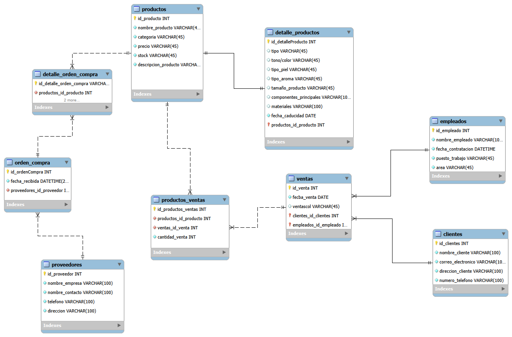

# Tienda de Maquillaje - Base de Datos Relacional

* **Desarrollador:** Alfredo Carrera
* **Descripción General:** <br> Este proyecto consiste en el diseño, modelado e implementación de una base de datos relacional orientada a optimizar la gestión integral de una tienda de maquillaje. El sistema permite administrar eficientemente el inventario de productos (clasificados en cosméticos, cuidado de la piel, perfumes y accesorios), el registro de clientes, el control de empleados, el historial de ventas y las órdenes de compra con proveedores. Para garantizar la optimización y escalabilidad, se implementó una separación limpia de entidades mediante llaves foráneas con borrado en cascada (`ON DELETE CASCADE`), así como procedimientos almacenados y funciones para consultas analíticas avanzadas.

---

## 1. Modelo Entidad-Relación (UML)

El diagrama de la base de datos estructura las tablas principales, las entidades dependientes y las tablas intermedias necesarias para manejar relaciones de muchos a muchos (`N:M`) y de uno a uno (`1:1`).



---

## 2. Estructura de la Base de Datos (DDL y DML)

La creación de las tablas se divide en tres niveles lógicos para respetar la integridad referencial de las claves foráneas. Además, se cuenta con un archivo DML que inicializa la base de datos con 20 registros por cada tabla.

### Archivo `DDL.sql` (Ejemplo de Creación de Tablas)
A continuación se muestra un fragmento clave del diseño que incluye la tabla principal `productos` y su tabla dependiente `detalle_productos` en una relación de 1 a 1:

```sql
-- Tabla principal de productos (Entidad fuerte)
CREATE TABLE productos (
    id_producto INT AUTO_INCREMENT PRIMARY KEY,
    nombre_producto VARCHAR(45) NOT NULL,
    categoria VARCHAR(45) NOT NULL,
    precio DECIMAL(10,2) NOT NULL,
    stock INT NOT NULL,
    descripcion_producto VARCHAR(255)
);

-- Tabla de detalles de productos (Relación 1 a 1 con productos)
CREATE TABLE detalle_productos (
    id_detalleProducto INT AUTO_INCREMENT PRIMARY KEY,
    tipo VARCHAR(45),
    tono_color VARCHAR(45),
    tipo_piel VARCHAR(45),
    tipo_aroma VARCHAR(45),
    tamaño_producto VARCHAR(45),
    componentes_principales VARCHAR(100),
    materiales VARCHAR(100),
    fecha_caducidad DATE,
    productos_id_producto INT NOT NULL UNIQUE,
    
    FOREIGN KEY (productos_id_producto) 
    REFERENCES productos(id_producto) 
    ON DELETE CASCADE 
    ON UPDATE CASCADE
);
```
Explicación: La tabla productos almacena los datos generales compartidos por cualquier artículo. Por su parte, detalle_productos almacena las características específicas de cada categoría (como tono, tipo de piel o aroma) vinculándose mediante una clave foránea única (productos_id_producto), lo que evita redundancias y campos nulos innecesarios en la tabla principal.  

### Archivo DML.sql:

El archivo contiene las inserciones masivas para poblar el sistema. Ejemplo de inserción en la tabla productos:
``` sql 
SQLINSERT INTO productos (nombre_producto, categoria, precio, stock, descripcion_producto) VALUES
('Base Líquida Matte', 'cosméticos', 18.50, 50, 'Base de alta cobertura acabado matte'),
('Crema Hidratante Facial', 'cuidado_piel', 22.00, 40, 'Crema con ácido hialurónico para piel seca');
```
## 3. Procedimientos Almacenados y Funciones (DQL.sql):

Para optimizar la recuperación de información y la lógica de negocio, se implementaron procedimientos almacenados (para consultas complejas que devuelven conjuntos de registros) y funciones (para cálculos escalares).   

```sql
Procedimientos Almacenados (1 al 5)

1. Listar cosméticos por tipo específico: 

SQLDELIMITER //
CREATE PROCEDURE SpListarCosmeticosPorTipo(IN p_tipo VARCHAR(45))
BEGIN
    SELECT p.id_producto, p.nombre_producto, p.categoria, p.precio, p.stock, d.tipo, d.tono_color
    FROM productos p
    INNER JOIN detalle_productos d ON p.id_producto = d.productos_id_producto
    WHERE p.categoria = 'cosméticos' AND d.tipo = p_tipo;
END //
DELIMITER ;
Uso: CALL SpListarCosmeticosPorTipo('Labial');   


2.Productos por categoría con stock inferior a un límite:   

SQLDELIMITER //
CREATE PROCEDURE SpProductosStockInferior(IN p_categoria VARCHAR(45), IN p_stock_limite INT)
BEGIN
    SELECT id_producto, nombre_producto, categoria, precio, stock
    FROM productos
    WHERE categoria = p_categoria AND stock < p_stock_limite;
END //
DELIMITER ;
Uso: CALL SpProductosStockInferior('cuidado_piel', 40);   


3. Ventas por cliente en un rango de fechas:

SQLDELIMITER //
CREATE PROCEDURE SpVentasPorClienteYFecha(IN p_id_cliente INT, IN p_fecha_inicio DATE, IN p_fecha_fin DATE)
BEGIN
    SELECT v.id_venta, v.fecba_venta, c.nombre_cliente, e.nombre_empleado, v.ventascol
    FROM ventas v
    INNER JOIN clientes c ON v.clientes_id_clientes = c.id_clientes
    INNER JOIN empleados e ON v.empleados_id_empleado = e.id_empleado
    WHERE c.id_clientes = p_id_cliente AND v.fecba_venta BETWEEN p_fecha_inicio AND p_fecha_fin;
END //
DELIMITER ;


4. Total de ventas realizadas por un empleado en un mes dado:

SQLDELIMITER //
CREATE PROCEDURE SpTotalVentasEmpleadoMes(IN p_id_empleado INT, IN p_mes INT, IN p_anio INT)
BEGIN
    SELECT e.nombre_empleado, COUNT(DISTINCT v.id_venta) AS total_facturas_atendidas, SUM(pv.cantidad_venta) AS total_unidades_vendidas
    FROM ventas v
    INNER JOIN empleados e ON v.empleados_id_empleado = e.id_empleado
    INNER JOIN productos_ventas pv ON v.id_venta = pv.ventas_id_venta
    WHERE e.id_empleado = p_id_empleado AND MONTH(v.fecba_venta) = p_mes AND YEAR(v.fecba_venta) = p_anio;
END //
DELIMITER ;


5. Productos más vendidos en un período determinado:   

SQLDELIMITER //
CREATE PROCEDURE SpProductosMasVendidosPeriodo(IN p_fecha_inicio DATE, IN p_fecha_fin DATE)
BEGIN
    SELECT p.id_producto, p.nombre_producto, p.categoria, SUM(pv.cantidad_venta) AS total_vendido
    FROM productos p
    INNER JOIN productos_ventas pv ON p.id_producto = pv.productos_id_producto
    INNER JOIN ventas v ON pv.ventas_id_venta = v.id_venta
    WHERE v.fecba_venta BETWEEN p_fecha_inicio AND p_fecha_fin
    GROUP BY p.id_producto, p.nombre_producto, p.categoria
    ORDER BY total_vendido DESC;
END //
DELIMITER ;

Funciones (6 al 10)
6. Consultar stock disponible por ID de producto:  

SQLDELIMITER //
CREATE FUNCTION FnConsultarStock(p_id_producto INT) RETURNS INT
DETERMINISTIC
BEGIN
    DECLARE v_stock INT;
    SELECT stock INTO v_stock FROM productos WHERE id_producto = p_id_producto;
    RETURN v_stock;
END //
DELIMITER ;
Uso: SELECT FnConsultarStock(1);  


7. Total de órdenes de compra a un proveedor en el último año:   

SQLDELIMITER //
CREATE FUNCTION FnTotalOrdenesUltimoAnio(p_id_proveedor INT) RETURNS INT
DETERMINISTIC
BEGIN
    DECLARE v_total INT;
    SELECT COUNT(*) INTO v_total FROM orden_compra 
    WHERE proveedores_id_proveedor = p_id_proveedor AND fecha_recibida >= (NOW() - INTERVAL 1 YEAR);
    RETURN v_total;
END //
DELIMITER ;


8. Cantidad de empleados con más de un año de antigüedad:   

SQLDELIMITER //
CREATE FUNCTION FnEmpleadosAntiguedadMayorUnAnio() RETURNS INT
DETERMINISTIC
BEGIN
    DECLARE v_cantidad INT;
    SELECT COUNT(*) INTO v_cantidad FROM empleados WHERE fecha_contratacion <= (NOW() - INTERVAL 1 YEAR);
    RETURN v_cantidad;
END //
DELIMITER ;

9. Cantidad total de productos vendidos en un día específico:   

SQLDELIMITER //
CREATE FUNCTION FnTotalProductosVendidosDia(p_fecha DATE) RETURNS INT
DETERMINISTIC
BEGIN
    DECLARE v_total_unidades INT;
    SELECT COALESCE(SUM(pv.cantidad_venta), 0) INTO v_total_unidades
    FROM productos_ventas pv INNER JOIN ventas v ON pv.ventas_id_venta = v.id_venta
    WHERE v.fecba_venta = p_fecha;
    RETURN v_total_unidades;
END //
DELIMITER ;


10. Unidades totales vendidas de un producto específico:   

SQLDELIMITER //
CREATE FUNCTION FnUnidadesVendidasPorProducto(p_id_producto INT) RETURNS INT
DETERMINISTIC
BEGIN
    DECLARE v_total_vendido INT;
    SELECT COALESCE(SUM(cantidad_venta), 0) INTO v_total_vendido 
    FROM productos_ventas WHERE productos_id_producto = p_id_producto;
    RETURN v_total_vendido;
END //
DELIMITER ;
```

4. Estructura del Repositorio. A continuación se muestra la organización de los archivos y carpetas del proyecto dentro del entorno de desarrollo:   

```Plaintext
T8_tiendaMaquillaje/
│
├── img/
│   └── tienda_maquillaje.png
├── DDL.sql
├── DML.sql
├── DQL.sql
└── README.md
```